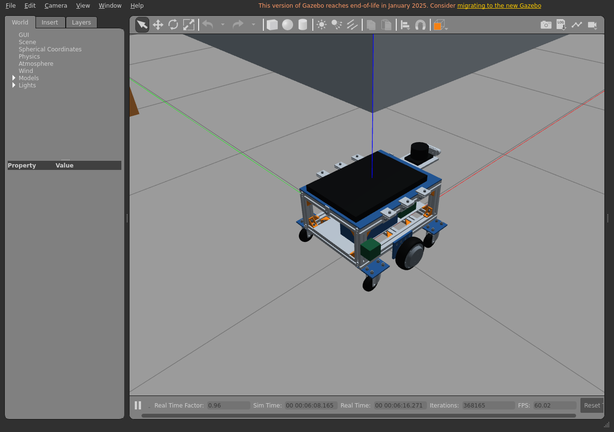

# 사용자 추종 자율주행 운반 로봇



[35초 시뮬레이션 영상](outputs/media/robot_gazebo_rviz_corner_35s.mp4) · [발표자료](presentation/사용자_추종_자율주행_운반_로봇_캡스톤_발표자료.pptx)


## 1. 프로젝트와 현재 구현 범위

본 프로젝트는 작업자가 실내 창고의 여러 선반을 이동하며 물품을 모으는 과정에서 운반 부담을 줄이는 사용자 추종 자율주행 운반 로봇을 개발하는 것을 목표로 합니다. 최종적으로 사람 인식·추적과 자율주행 기술을 결합하고, 키링과 같은 작은 표식을 사용자 식별의 보조 정보로 활용하는 방식을 연구하고자 합니다.

구동 구조는 MDH100 인휠모터 2개와 회전 캐스터 4개를 사용하는 2WD 구조로 설계했습니다. 알루미늄 3030 프로파일 프레임을 바탕으로 모터 축 고정판, 캐스터 장착판과 높이 조절심, 배터리·모터 드라이버·센서의 배치를 검토하고 CAD 도면에 반영했습니다.

실물 구성은 기존 노트북, MD200T 모터 드라이버, LiDAR, RealSense D435 등을 기준으로 선정했으며, 구매목록과 전원·통신 배선 구성을 정리했습니다.
가상 공간에서 로봇을 키보드로 조종하며 LiDAR 데이터를 수집하고, SLAM Toolbox를 이용해 지도를 생성했습니다. 생성한 지도는 이미지와 YAML 파일로 저장했습니다.
이후 저장 지도를 불러와 AMCL로 로봇 위치를 추정하고, Nav2를 이용해 지정한 목표 위치까지 이동하도록 구성했습니다. RViz에서는 지도, 레이저 스캔, 좌표계 및 계획 경로를 확인할 수 있도록 설정했습니다.

직선 이동만으로는 실제 운반 작업을 충분히 평가하기 어렵기 때문에, 복도와 교차로 및 고정 장애물이 있는 환경을 구성했습니다. 코너 회전, 장애물 옆 통과, 연속 목표 이동 과정에서 주행 실패와 장애물 근접 현상을 확인하고 제어 설정을 조정했습니다.
또한 여러 위치를 순서대로 방문하는 다중 목표 주행 기능을 구성하여, 단일 목표 이동뿐 아니라 연속적인 이동 임무를 시험했습니다.

현재 제출 코드는 **MDH100 2WD + 회전 캐스터 4개 모델의 Gazebo Classic 시뮬레이션, SLAM, 저장 지도 기반 Nav2 주행 및 코너 시험**입니다.
사람 인식·추적은 별도 컴퓨터 비전 실습 화면을 첨부했습니다. **사람·작은 표식 결합 추종, D435 실시간 영상 노드, MD200T 실물 통신 및 실물 안전 제어는 아직 이 코드에 구현되어 있지 않습니다.**

## 2. 폴더 구성

```text
user-following-autonomous-transport-robot/
  presentation/  제출용 PPT와 해당 순서의 발표 대본
  src/physical_ai_robot_description/  ROS 2 패키지, URDF, CAD 메시, 맵, 월드, 설정
  scripts/       빌드·실행·키보드 조종·지도 저장·코너 시험
  config/        DDS 통신 설정, 선택한 튜닝 원본
  outputs/       기존 시험 데이터, 실제 실행 화면 및 35초 시연 영상
  docs/          구현 범위, 4WD/2WD 선정 이유, 과거 시험 기록
  requirements.txt  Python 보조 의존성 안내
```

## 3. 실행 환경

- Ubuntu 22.04, ROS 2 Humble, Gazebo Classic 11, Python 3.10.
- Windows는 WSL2 Ubuntu 22.04 및 WSLg 화면 표시 환경에서 실행합니다.
- Gazebo Sim(최신 gz sim)용 패키지가 아닙니다. 기존 검증 환경을 재현하기 위해 Classic을 사용합니다.
- 그래픽 가속이 없으면 시뮬레이션이 느려질 수 있습니다.
- 시뮬레이션은 rtx40시리즈로 진행하였습니다
- 모델 메시와 지도는 포함되어 있어 CAD 프로그램과 외부 모델 다운로드가 필요하지 않습니다.

ROS 2 Humble이 이미 설치된 Ubuntu 터미널에서 다음 의존성을 설치합니다.
```bash
sudo apt update
sudo apt install python3-colcon-common-extensions python3-yaml \
  ros-humble-gazebo-ros-pkgs ros-humble-robot-state-publisher ros-humble-xacro \
  ros-humble-navigation2 ros-humble-nav2-bringup ros-humble-slam-toolbox \
  ros-humble-rviz2 ros-humble-teleop-twist-keyboard \
  ros-humble-nav2-rotation-shim-controller
```
`pip install -r requirements.txt`만으로 ROS 2나 Gazebo가 설치되지는 않습니다.

## 4. 최초 빌드

GitHub에서 저장소를 복제하거나 ZIP을 압축 해제한 뒤 **이 README.md가 있는 프로젝트 폴더 안에서** 터미널을 엽니다. WSL에서는 Windows 경로가 `/mnt/c/...`로 보입니다. 공백이 있는 경로에는 따옴표를 사용합니다.
```bash
cd '/mnt/c/프로젝트가 있는 경로/user-following-autonomous-transport-robot'
bash scripts/build.sh
```
소스를 Linux의 `~/capstone_robot_ws`로 복사해 빌드합니다. 다른 작업공간은 `export CAPSTONE_WS="$HOME/원하는_작업공간"`으로 지정하고 모든 터미널에서 동일하게 사용합니다.

## 5. 저장 지도로 바로 주행 — 발표 시 권장

터미널 1:
```bash
bash scripts/run.sh nav
```
Gazebo, Nav2, RViz가 함께 열립니다. 시작 직후 초기화가 끝날 때까지 기다립니다. 이 시뮬레이션은 알려진 원점에 로봇을 생성하고 AMCL 초기 위치를 설정합니다. RViz의 지도와 스캔이 일치하는지 확인한 뒤 `2D Goal Pose`로 목표를 지정합니다. `2D Pose Estimate`는 실제 생성 위치와 방향이 다를 때 수정하는 도구이며, 로봇을 이동시키는 도구가 아닙니다.

터미널 2를 같은 폴더에서 열고 네 코너 자동 시험:
```bash
bash scripts/test_route.sh loop
```
시험 도중 키보드 조종, RViz 목표 클릭, 모델 Pose Reset을 함께 사용하지 않습니다. 기본 월드와 무적재 모델에서만 기존 시험 경로 및 여유 계산이 일치합니다.
새 시험 기록은 `output/cad_v11_corridor_tuning/`에 생성됩니다. `outputs/recorded_tests/`는 11월 18일 기존 증거 자료로 별도 보관했습니다.

## 6. 새 지도 작성

기존 실행을 Ctrl+C로 종료한 뒤 터미널 1:
```bash
bash scripts/run.sh slam
```
터미널 2:
```bash
bash scripts/teleop.sh
```
조종 터미널을 선택하고 `i` 전진, `,` 후진, `j` 제자리 좌회전, `l` 제자리 우회전, `k` 정지. 화면에 표시되는 키 안내를 참고합니다.

터미널 3에서 저장:
```bash
bash scripts/save_map.sh my_corridor
```
성공 로그와 `outputs/maps/my_corridor.yaml`, `.pgm` 파일 생성 여부를 확인합니다. 지도 작성 실행을 Ctrl+C로 종료한 후:
```bash
bash scripts/run.sh nav "map:=$(pwd)/outputs/maps/my_corridor.yaml"
```
지도만 저장되며, Gazebo에서 임의로 바꾼 장애물 배치는 별도로 월드에 저장해야 합니다.

## 7. 모델만 보기와 종료

```bash
bash scripts/run.sh view
```
실행 터미널에서 Ctrl+C로 종료합니다. 프로그램이 닫히는 것을 확인한 다음 새 모드를 실행합니다. 기존 Gazebo가 있으면 실행 스크립트가 중복 실행을 막습니다.

## 8. 주요 파일과 알고리즘

- `urdf/cad_v11_robot.xacro`: 두 구동륜, 네 수동 회전/구름 캐스터, 라이다와 차체 물리 설정.
- `urdf/cad_v11_generated.xacro`, `meshes/cad_v11/`: CAD에서 변환한 외형·질량·관성 추정.
- `config/nav2_mdh100.yaml`: 현재 선택한 Nav2 설정. **NavFn / use_astar=false**, DWB + RotationShim.
- `scripts/sim_motion_guard.py`(패키지 내부): 시뮬레이션 속도·가속도 제한과 오래된 명령 처리. 실물 안전 인증 장치가 아님.
- `scripts/test_cad_v11_corridors.py`(프로젝트 루트): 목표 전송, 시간·경로 길이·기하학적 여유 기록.

## 9. 재현 확인과 문제 해결

```bash
python3 scripts/validate_package.py
source scripts/env.sh
ros2 node list
ros2 topic list
```
- 화면이 격자만 보임: `/map`, `/scan`, TF 및 Fixed Frame을 확인합니다. `view` 모드에서는 map을 생성하지 않습니다.
- `map` 좌표계 없음: nav/slam 모드를 확인합니다. Nav2·AMCL 또는 SLAM이 초기화되었는지 확인합니다.
- DDS 공유 메모리 오류: 보조 터미널도 `source scripts/env.sh`를 실행해 같은 UDP 설정을 사용합니다.
- 지도 저장 실패: SLAM과 `/map` 발행 상태, 저장 성공 로그를 확인합니다.
- 모델/시간 Reset 후 TF 경고: 관련 launch를 종료하고 함께 다시 시작합니다.
- 캐스터·마찰값과 오도메트리는 시뮬레이션 가정입니다. 실물에 설정을 그대로 복사하지 않습니다.

`docs/history/`는 당시 작업 기록이라 옛 경로/실행 상태가 포함될 수 있습니다. 이 제출본의 실행은 본 README를 기준으로 합니다.
추가 검증 결과는 `docs/submission_validation.txt`를 참고하십시오.
